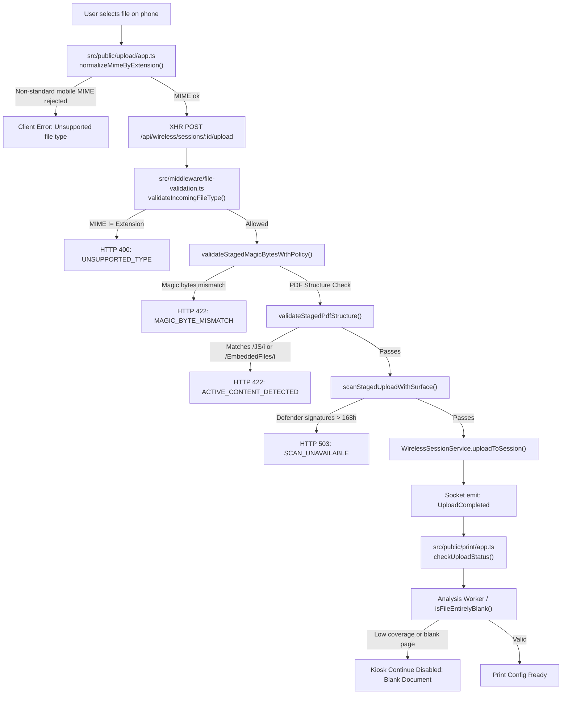

# Admin Anomaly Alerts & Upload-to-Print Investigation Report

## 1. Executive Summary

Inspection of the 3 admin anomaly screenshots and the codebase across `src/public/upload` and `src/public/print` reveals that uploads fail not only because of magic byte mismatches, but primarily due to **overly strict structural regex filters**, **antivirus signature staleness gates**, and **mobile MIME type mismatches**.

---

## 2. Screenshot Breakdown & Exact Code Locations

| Screenshot                                          | Anomaly Type                     | Occurrences | Severity | Primary File & Exact Line Location                                             |
| :-------------------------------------------------- | :------------------------------- | :---------- | :------- | :----------------------------------------------------------------------------- |
| **Screenshot 1** (`Screenshot_20261023-084147.jpg`) | `unexpected_restart_detected`    | 2           | Critical | `D:\giomj\Projects\printbit\src\server.ts` (Lines 697–755)                     |
| **Screenshot 2** (`Screenshot_20261023-084159.jpg`) | `upload_active_content_detected` | 10          | Critical | `D:\giomj\Projects\printbit\src\middleware\file-validation.ts` (Lines 676–699) |
| **Screenshot 3** (`Screenshot_20261023-084213.jpg`) | `upload_antivirus_unavailable`   | 5           | Critical | `D:\giomj\Projects\printbit\src\services\defender-scanner.ts` (Lines 339–353)  |

---

### Screenshot 1: `unexpected_restart_detected`

- **Alert Message**: `"Unplanned restart detected. Startup recovery reconciliation has been executed."`
- **Source**: `recovery`
- **Exact File Path**: `D:\giomj\Projects\printbit\src\server.ts` (Lines 697–755)
- **Code Reference**:

  ```ts
  // Lines 697-745 in src/server.ts
  const startupMarker = await markRecoveryStartup('server_start');
  const recoverySummary = await reconcileRecoverySessionsOnStartup();
  if (startupMarker.unexpectedRestart) {
    void anomalyService.report({
      type: 'unexpected_restart_detected',
      source: 'recovery',
      category: 'security',
      severity: 'critical',
      message: 'Unplanned restart detected. Startup recovery reconciliation has been executed.',
      ...
    });
  }
  ```

- **Root Cause**:
  The kiosk Node process exited abruptly without executing standard termination handlers (e.g. system power outage, Windows OS reboot, blue screen, or process kill). On boot, the server notes the missing clean shutdown marker. This terminates all active wireless upload sessions and invalidates tokens currently held by phones connected to the kiosk.

---

### Screenshot 2: `upload_active_content_detected`

- **Alert Message**: `"Upload rejected because file content validation failed against declared document type."`
- **Failed File**: `case study.pdf` (52,009 bytes)
- **Details from Alert**:
  - `declaredMimeType: "application/pdf"`
  - `detectedMimeType: "application/pdf"`
  - `detectedExecutableExtension: null`
  - `validationReason: "ACTIVE_CONTENT_DETECTED"`
  - `occurrences: 10`
- **Exact File Paths**:
  1. Backend Validator: `D:\giomj\Projects\printbit\src\middleware\file-validation.ts` (Lines 676–699)
  2. Mobile Upload Error Mapping: `D:\giomj\Projects\printbit\src\public\upload\app.ts` (Lines 377–380)
  3. Kiosk Print Rejection UI: `D:\giomj\Projects\printbit\src\public\print\app.ts` (Lines 1228–1241)
- **Code Reference**:

  ```ts
  // Lines 676-696 in src/middleware/file-validation.ts
  export async function validateStagedPdfStructure(
    filePath: string,
    fileSize: number,
    readRangeFn: typeof readStagedFileRange,
  ): Promise<{ valid: boolean; reason?: QuarantineReason }> {
    const inspectSize = Math.min(fileSize, 4 * 1024 * 1024);
    const buffer = await readRangeFn(filePath, 0, inspectSize);
    const text = buffer.toString('latin1');

    const forbiddenPdfTokens = [
      /\/JavaScript\b/i,
      /\/JS\b/i,
      /\/Launch\b/i,
      /\/EmbeddedFiles\b/i,
    ];

    for (const token of forbiddenPdfTokens) {
      if (token.test(text)) {
        return { valid: false, reason: 'ACTIVE_CONTENT_DETECTED' };
      }
    }

    return { valid: true };
  }
  ```

- **Root Cause**:
  1. Notice that `declaredMimeType` and `detectedMimeType` are both `application/pdf`. The magic bytes check (`%PDF`) **passed successfully**.
  2. The function converts up to 4 MB of raw binary PDF data to a `latin1` string.
  3. The regex `/\/JS\b/i` has the case-insensitive flag `/i`. Inside binary compressed streams (FlateDecode chunks, embedded subsets of fonts, ICC color profiles), the two bytes `/` (0x2F) and `j` (0x6A) or `J` (0x4A) followed by `s`/`S` and a non-word boundary occur by pure statistical probability in arbitrary binary streams.
  4. Legitimate PDFs (e.g. exported from Microsoft Word, Canva, Google Docs, LaTeX, or Acrobat) also include standard `/EmbeddedFiles` dictionaries (e.g. PDF/A color profiles, fonts, metadata).
  5. As a result, standard user PDFs trigger `ACTIVE_CONTENT_DETECTED`, returning HTTP 422 `DISGUISED_FILE`. The user in Screenshot 2 attempted to upload `case study.pdf` 10 times and was blocked on every attempt.

---

### Screenshot 3: `upload_antivirus_unavailable`

- **Alert Message**: `"Upload blocked because Microsoft Defender scanner is stale."`
- **Failed File**: `The Murder of Server ARES-01.docx`
- **Details from Alert**:
  - `scannerHealth: "stale"`
  - `signatureAgeHours: 176.2137141666668`
  - `scannerDetail: "Defender signatures are 176 hours old (maximum allowed: 168)."`
  - `occurrences: 5`
- **Exact File Paths**:
  1. Signature Age Logic: `D:\giomj\Projects\printbit\src\services\defender-scanner.ts` (Lines 339–353)
  2. Middleware Gate: `D:\giomj\Projects\printbit\src\middleware\file-validation.ts` (Lines 910–951)
  3. Mobile Upload Error Handler: `D:\giomj\Projects\printbit\src\public\upload\app.ts` (Lines 381–384)
- **Code Reference**:

  ```ts
  // Lines 339-347 in src/services/defender-scanner.ts
  const now = Date.now();
  const ageHours = (now - updatedTimeMs) / (1000 * 60 * 60);

  if (ageHours > this.config.maxSignatureAgeHours) {
    return {
      status: 'stale',
      signatureAgeHours: ageHours,
      detail: `Defender signatures are ${Math.round(ageHours)} hours old (maximum allowed: ${this.config.maxSignatureAgeHours}).`,
    };
  }
  ```

  ```ts
  // Lines 910-950 in src/middleware/file-validation.ts
  const health = await scanner.getHealth();
  if (health.status !== 'clean') {
    await discardFn(file);
    ...
    res.status(503).json({
      code: 'SCAN_UNAVAILABLE',
      error: 'Malware scanning service is temporarily unavailable. Upload was rejected.',
    });
    return;
  }
  ```

- **Root Cause**:
  `maxSignatureAgeHours` is strictly capped at 168 hours (7 days). If the kiosk PC does not have constant internet access or Windows Defender definition updates stall for more than 7 days, `scannerHealth` transitions to `'stale'`.
  When `health.status !== 'clean'`, the upload route rejects **100% of all incoming files** with HTTP 503 `SCAN_UNAVAILABLE`.

---

## 3. End-to-End Analysis: Why Files Don't Send from Upload to Print

### Flow Diagram



---

### Detailed Code Occurrences

#### 1. Client-Side Mobile MIME Mismatch

- **File**: `D:\giomj\Projects\printbit\src\public\upload\app.ts` (Lines 278–340)
- **Problem**:

  ```ts
  function normalizeMimeByExtension(fileName: string, mimeType: string): string | null {
    const normalizedMime = mimeType.trim().toLowerCase();
    const ext = extOf(fileName);
    ...
    if (normalizedMime !== '' && normalizedMime !== 'application/octet-stream') {
      return normalizedMime;
    }
    return extensionMimeMap[ext] ?? null;
  }
  ```

  On Android and iOS, file pickers often send non-standard MIME types (e.g. `application/x-pdf`, `application/vnd.pdf`, `image/pjpeg`, `image/x-png`).
  Because `normalizedMime !== ''`, the function does not use the extension fallback.
  In `collectUnsupportedFiles()`, `allowedMimeTypes.has(normalized)` evaluates to `false`, and the user is blocked before the upload request is even sent.

#### 2. Backend MIME and Extension Verification

- **File**: `D:\giomj\Projects\printbit\src\middleware\file-validation.ts` (Lines 327–358 and 407–436)
- **Problem**:
  Even if a file bypasses the client-side check, the backend checks:

  ```ts
  if (!policy.allowedMimeTypes.has(incomingMime)) { ... cb(new Error('Invalid file type')); }
  ```

  and:

  ```ts
  if (expectedMime && expectedMime !== normalizedMime && !isBothImages) {
    // Rejects with EXTENSION_MIME_MISMATCH
  }
  ```

  Non-standard MIME strings from mobile devices trigger rejection.

#### 3. Overly Strict PDF Binary Regex Scan

- **File**: `D:\giomj\Projects\printbit\src\middleware\file-validation.ts` (Lines 685–696)
- **Problem**:
  Scanning arbitrary compressed binary data with `/\/JS\b/i` and `/\/EmbeddedFiles\b/i` creates high false-positive rates on normal documents exported from Microsoft Word, Google Docs, Canva, or LaTeX.

#### 4. Kiosk Defender Signature Expiration Lockout

- **File**: `D:\giomj\Projects\printbit\src\services\defender-scanner.ts` (Lines 339–347)
- **Problem**:
  When signatures pass 168 hours old without an update, every upload fails with `SCAN_UNAVAILABLE` (HTTP 503).

#### 5. Kiosk Page Analysis & Blank Document Gate

- **File**: `D:\giomj\Projects\printbit\src\public\print\app.ts` (Lines 44–56 and 1492–1499)
- **Problem**:
  After a file arrives on the kiosk, `isFileEntirelyBlank()` checks if page coverage is `< 0.001`. If a document is flagged blank (or rasterization analysis returns minimal ink coverage), the kiosk permanently disables the "Continue" button and displays:
  `"Cannot proceed: ... is a blank document and cannot be printed."`

#### 6. Wi-Fi Without Internet vs Cellular Data Routing

- **File**: `D:\giomj\Projects\printbit\src\public\upload\app.ts` (Lines 836–843)
- **Problem**:
  The phone screenshot shows `VoLTE 4G` alongside Wi-Fi. Mobile operating systems frequently route HTTP calls over cellular data when the connected Wi-Fi has no WAN internet access. When this occurs, calls to `192.168.4.1` fail with `Network error` or `Cannot reach kiosk`.

---

## 4. Summary of Key Files

| Component                       | Absolute Path                                                                            |
| :------------------------------ | :--------------------------------------------------------------------------------------- |
| **Mobile Upload Client**        | `D:\giomj\Projects\printbit\src\public\upload\app.ts`                                    |
| **Kiosk Print Client**          | `D:\giomj\Projects\printbit\src\public\print\app.ts`                                     |
| **Upload Security Middleware**  | `D:\giomj\Projects\printbit\src\middleware\file-validation.ts`                           |
| **Antivirus Scanner Service**   | `D:\giomj\Projects\printbit\src\services\defender-scanner.ts`                            |
| **Wireless Session Controller** | `D:\giomj\Projects\printbit\src\modules\wireless-session\wireless-session.controller.ts` |
| **Wireless Session Service**    | `D:\giomj\Projects\printbit\src\modules\wireless-session\wireless-session.service.ts`    |
| **Startup / Recovery Server**   | `D:\giomj\Projects\printbit\src\server.ts`                                               |
| **File Type Definitions**       | `D:\giomj\Projects\printbit\src\utils\file-types.ts`                                     |
