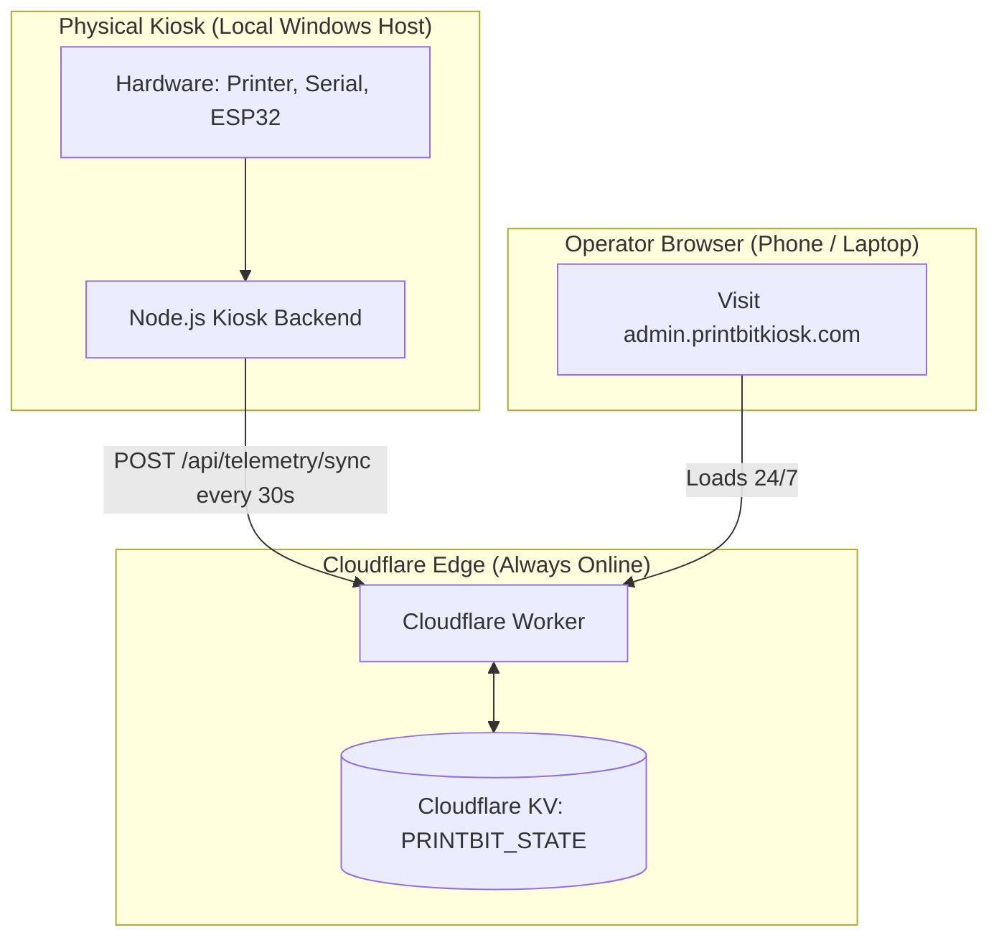

# Always-On Admin Portal & Cloud Edge Telemetry Design

## 1. Overview & Problem Statement

Currently, `admin.printbitkiosk.com` is routed via Cloudflare Tunnel directly to the physical kiosk machine's local server (`localhost:3000`).

### The Problem

When the physical kiosk machine is turned off, powered down, or in sleep/maintenance:

- The local Node.js server and Cloudflare Tunnel daemon (`cloudflared`) are completely offline.
- Visiting `admin.printbitkiosk.com` throws a Cloudflare Error 502 (Bad Gateway) or Error 530 (Tunnel Error).
- Administrators cannot verify whether the machine is open or closed, nor can they view previous earnings, ink levels, or last-seen timestamps without physical on-site inspection.

### The Solution

Decouple the entry point `admin.printbitkiosk.com` from the physical hardware by deploying a lightweight, serverless **Cloudflare Worker with Cloudflare KV (`PRINTBIT_STATE`)**:

1. **Always Online:** `admin.printbitkiosk.com` is hosted at the Cloudflare edge 24/7. It loads instantly regardless of the physical machine's power state.
2. **Periodic State Sync:** While the kiosk is running, a background service pushes a telemetry snapshot every 30 seconds to the Worker's ingest endpoint (`POST /api/telemetry/sync`).
3. **Dynamic State Rendering:**
   - **Open / Online:** If telemetry arrived within the last 90 seconds, the portal displays a green **"🟢 Kiosk Open / Online"** banner and live stats.
   - **Closed / Powered Off:** If telemetry is older than 90 seconds, the portal displays a red **"🔴 Kiosk Closed / Powered Off"** banner with a human-readable "Last seen X minutes/hours ago" timestamp, while keeping the last known earnings, ink levels, and transaction counts visible.

---

## 2. Architecture & Data Flow



---

## 3. Data Contracts

### 3.1 Kiosk Telemetry Snapshot (`POST /api/telemetry/sync`)

The physical kiosk transmits this snapshot over HTTPS:

```json
{
  "kioskId": "printbit-kiosk-01",
  "timestamp": "2026-10-31T03:45:00.000Z",
  "status": "healthy",
  "uptimeSec": 14200,
  "hardware": {
    "printer": "healthy",
    "serial": "healthy",
    "worker": "healthy",
    "hotspot": "healthy"
  },
  "summary": {
    "earningsToday": 1450,
    "jobsToday": 52,
    "owedChange": 0,
    "inkGrayscale": 85,
    "inkColor": 70,
    "issues": []
  }
}
```

**Authentication:** Kiosk transmits header `Authorization: Bearer <PRINTBIT_CLOUD_SYNC_SECRET>`. The Worker verifies this secret against `env.SYNC_SECRET`.

### 3.2 Public Status API (`GET /api/kiosk-status`)

The admin frontend requests this endpoint to determine UI state:

```json
{
  "isOnline": true,
  "state": "healthy",
  "lastSeenAt": "2026-10-31T03:45:00.000Z",
  "ageMs": 14200,
  "data": {
    "summary": {
      "earningsToday": 1450,
      "jobsToday": 52,
      "owedChange": 0,
      "inkGrayscale": 85,
      "inkColor": 70
    },
    "hardware": {
      "printer": "healthy",
      "serial": "healthy"
    }
  }
}
```

If `ageMs >= 90000`, the worker overrides `isOnline: false` and `state: "offline"`.

---

## 4. Admin UI Experience & Behavior

| State                          | Indicator                                              | Metrics Display      | Action Buttons (Dispense, Reboot, Reset)                    |
| ------------------------------ | ------------------------------------------------------ | -------------------- | ----------------------------------------------------------- |
| **Kiosk Open / Online**        | `🟢 Kiosk Open / Operational`                          | Live Real-Time       | Enabled                                                     |
| **Kiosk Degraded**             | `⚠️ Kiosk Open / Hardware Degraded` (e.g. Paper Out)   | Live Real-Time       | Enabled with Warnings                                       |
| **Kiosk Powered Off / Closed** | `🔴 Kiosk Closed / Powered Off` (`Last seen: 8:30 PM`) | Last Cached Snapshot | Disabled with tooltip: _"Unavailable while machine is off"_ |

---

## 5. Deployment & Configuration

### Cloudflare Worker (`cloud/wrangler.jsonc` & `cloud/worker.ts`)

- **KV Binding:** `PRINTBIT_STATE`
- **Secrets:** `SYNC_SECRET` (configured via `npx wrangler secret put SYNC_SECRET`)
- **Route:** `admin.printbitkiosk.com/*`

### Kiosk Node Backend (`.env`)

```env
PRINTBIT_CLOUD_SYNC_ENABLED=true
PRINTBIT_CLOUD_SYNC_URL=https://admin.printbitkiosk.com/api/telemetry/sync
PRINTBIT_CLOUD_SYNC_SECRET=your-secret-token-here
PRINTBIT_CLOUD_SYNC_INTERVAL_SEC=30
```

---

## 6. Resilience & Security Boundaries

1. **Edge Isolation:** Even if the physical machine completely loses electrical power, the admin dashboard continues serving without crashing or error pages.
2. **Token Security:** Bearer token authentication prevents unauthorized telemetry spoofing.
3. **No PII:** Telemetry body includes only aggregate counts (earnings, jobs, hardware statuses); customer files and personal transaction records remain strictly local to the kiosk SQLite database.
