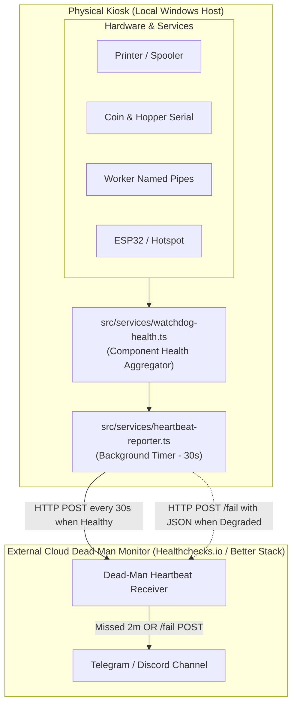

# Kiosk Operational Readiness & Dead-Man Heartbeat Design

## 1. Overview & Problem Statement
Currently, remote administrators rely solely on inbound Cloudflare Tunnel connectivity to port 3000 to determine if the physical PrintBit kiosk machine is "open" / operational.

### The Limitation
- **Liveness vs. Readiness:** An HTTP 200 via Cloudflare Tunnel only proves the Windows machine is booted and the Node.js process is bound to port 3000. It does not verify whether the printer is operational (jammed, out of paper, spooler error), whether the coin acceptor or coin hopper is connected, or whether the C# .NET hardware service is running.
- **Inbound Pull vs. Outbound Push:** If the kiosk suffers a power failure, circuit breaker trip, or Wi-Fi disconnection, the tunnel quietly fails. No notification is delivered until an administrator manually checks the URL or a customer complains.

### The Solution
Implement an outbound **Dead-Man Heartbeat Reporter** within the local PrintBit kiosk software that pushes continuous operational readiness telemetry to an external cloud monitor (e.g., Healthchecks.io / Better Stack), which automatically fires Telegram/Discord alerts on failure or silence.

---

## 2. Architecture & Data Flow



### Component Roles
1. **Health Aggregator (`watchdog-health.ts`):** Existing service monitoring `app`, `printer`, `serial`, and `hotspot`.
2. **Heartbeat Reporter (`heartbeat-reporter.ts`):** New background service. Queries the aggregator every 30 seconds.
3. **External Monitor (Cloud SaaS):** Expects a ping every 30 seconds with a 2-minute grace period. If no ping arrives or if `/fail` is called, dispatches a push notification to Telegram/Discord.

---

## 3. Operational States & Alerting Matrix

| State | Hardware Condition | Outbound Signal | Cloud Action | Alert Dispatched |
|---|---|---|---|---|
| **Healthy** | All subsystems operational | `POST <PING_URL>` (200 OK) | Reset dead-man timer | None (All Clear) |
| **Degraded** | Online, but hardware service failed (printer paper out, serial disconnected) | `POST <PING_URL>/fail` + Diagnostic JSON | Log incident | "⚠️ PrintBit Degraded: [Reason]" |
| **Offline** | Power lost, internet down, or Windows OS crash | No signal received for > 2 min | Dead-man timer expires | "🚨 PrintBit OFFLINE (Dead-man timeout)" |
| **Recovered**| Machine back online and all hardware restored | `POST <PING_URL>` | Resolve incident | "✅ PrintBit Restored: All systems healthy" |

---

## 4. Hardware Readiness Criteria

A state is marked **Healthy** only when all of the following conditions pass:
1. **Node.js Core (`app`):** Event loop responsive, process uptime valid.
2. **Printer Subsystem (`printer`):** Connected, spooler active, not in `BLOCKED_STATUSES` (`paper_out`, `jammed`, `door_open`, `offline`, `error`), telemetry fresh (<90s).
3. **Coin & Hopper Serial (`serial`):** Shared COM port is opened and communicating.
4. **C# Hardware Worker (`worker`):** Named-pipe IPC ping responsive.
5. **Mobile Upload Gateway (`hotspot`):** ESP32 service active.

If any check fails, the status becomes **Degraded**, and the reporter dispatches to `/fail` with the list of issues.

---

## 5. Configuration & Environment Variables

| Variable | Default | Purpose |
|---|---|---|
| `PRINTBIT_HEARTBEAT_ENABLED` | `false` | Enables/disables the outbound reporter (opt-in for production). |
| `PRINTBIT_HEARTBEAT_PING_URL` | (unset) | Full heartbeat endpoint URL (e.g. `https://hc-ping.com/<uuid>`). |
| `PRINTBIT_HEARTBEAT_INTERVAL_SEC` | `30` | Interval in seconds between pings (10–300). |
| `PRINTBIT_HEARTBEAT_TIMEOUT_MS` | `5000` | AbortSignal timeout for outbound HTTP request. |
| `PRINTBIT_HEARTBEAT_KIOSK_ID` | `printbit-kiosk-01` | Identifier sent in diagnostic payload. |

### Diagnostic Payload (for `/fail` and optional POST body)
```json
{
  "kioskId": "printbit-kiosk-01",
  "status": "degraded",
  "timestamp": "2026-10-31T03:00:00.000Z",
  "uptimeSec": 8420,
  "issues": [
    "Printer blocked: paper_out",
    "Serial disconnected on COM6"
  ],
  "components": {
    "app": "healthy",
    "printer": "degraded",
    "serial": "degraded",
    "hotspot": "healthy"
  }
}
```

---

## 6. Resilience & Security Boundaries

1. **Non-blocking Event Loop:** Outbound requests are governed by strict `AbortSignal.timeout(5000)`. Slow network responses cannot hang the kiosk.
2. **Fault Isolation:** Network errors during pinging are caught and logged at `warn` level; they never trigger uncaught rejections or terminate the Node.js process.
3. **Flap Suppression:** The cloud monitor applies a 2-minute grace period (4 missed pings). Single transient packet drops will not produce false alarms.
4. **Privacy:** The diagnostic payload contains zero customer files, transaction details, or personally identifiable information (PII).

---

## 7. Testing & Verification

1. **Unit Tests (`tests/unit/heartbeat-reporter.spec.ts`):**
   - Reporter remains inactive when `PRINTBIT_HEARTBEAT_ENABLED=false`.
   - Sends base URL ping on all healthy subsystems.
   - Appends `/fail` and transmits payload when any subsystem is degraded.
   - Gracefully handles HTTP timeouts and connection resets without throwing.
2. **Manual Admin Verification:**
   - Add admin trigger `POST /api/admin/heartbeat/test` to force an immediate ping and verify webhook delivery from the dashboard.
3. **Simulation Scenarios:**
   - Disconnect printer USB $\rightarrow$ verify Telegram receives degraded alert within 30s.
   - Disconnect kiosk Wi-Fi $\rightarrow$ verify Telegram receives dead-man offline alert after 2 minutes.
   - Reconnect Wi-Fi $\rightarrow$ verify Telegram receives recovery notification.
